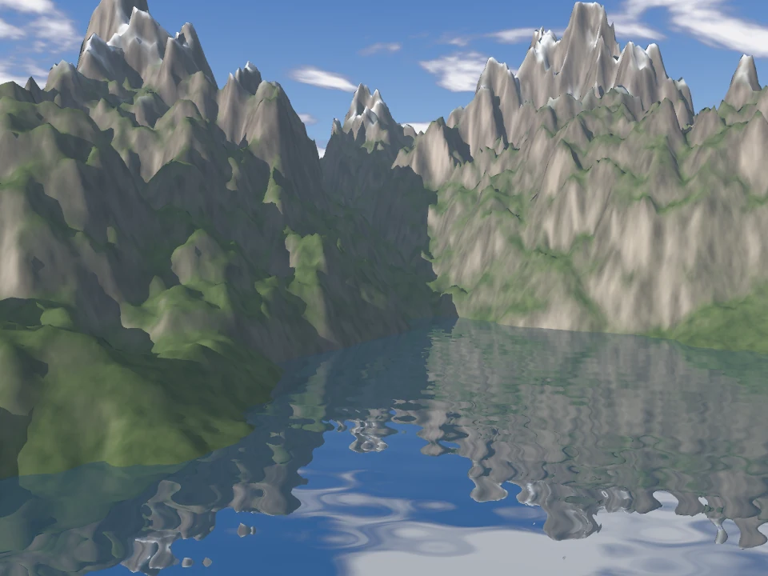
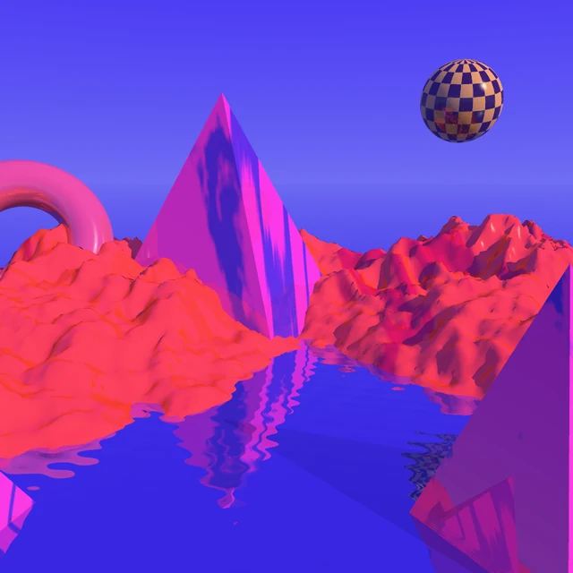
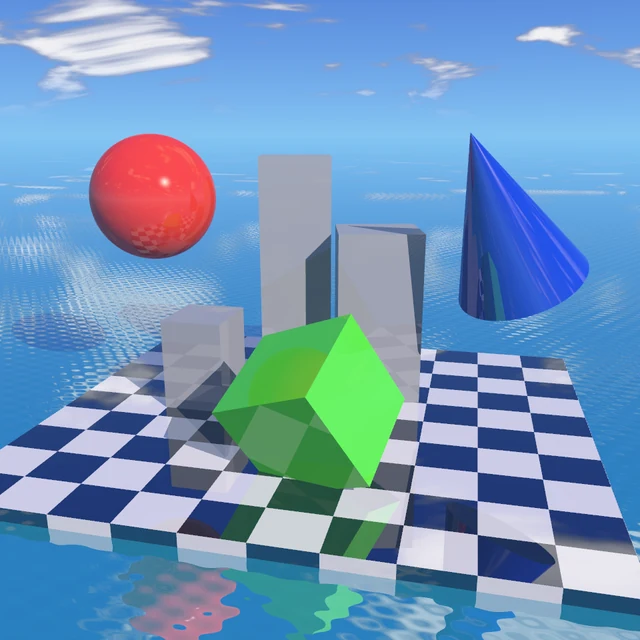
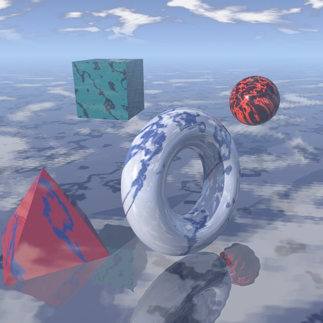

# Terrain Studio

A native Rust scene editor for the surreal early-3D look of Bryce 2. Compose glossy floating objects, marbled surfaces, checkerboard platforms and mirrored terrain. The desktop editor provides a live CPU ray-traced preview and exports antialiased PNGs.



## Starter scenes

| Neon Mirage | Checker Study | Mercury Plain |
| --- | --- | --- |
|  |  |  |

Open these presets from **Starter scenes** in the editor.

## Install and start

Build the package using the instructions below, then install it from the project directory. This example uses the amd64 build.

```sh
sudo apt install ./dist/terrain-studio_0.3.0_amd64.deb
terrain-studio
```

Use **Objects → Add object** to add primitives, import a Wavefront OBJ mesh, or place an image on a panel. Click an object in the camera view to select it. Drag to orbit and scroll to zoom. Transform the selected object and edit its material in the inspector. **Sky & water** controls the sky gradient, clouds, sun, and reflective plane. **Render PNG** sets the output size and writes the final image. **File → Save project** stores the editable scene and its imported geometry and image panels in a `.terrain` file.

Use **File → Open project** to open a Bryce 2 `.BRC` file. The importer restores positioned terrain, spheres and boxes with the perspective camera and saved render dimensions. Select an imported terrain and click **Edit elevation** to sculpt it. **File → Save project** saves the editable result as `.terrain`. Original materials, lighting, sky, Boolean groups and other geometry classes still need compatibility work.

Use **Terrain → Open Bryce ISO** to browse the TIFF heightmaps on the original disc. You can also import a standalone TIFF, PNG, JPEG, BMP or PNM image. Paint on the heightmap to raise the terrain and hold Shift to lower it. Use **Terrain → Open Bryce 2 scene** and choose a resource to bring a single elevation grid into the current project. The starter scenes work independently of the disc.

## Command-line rendering

The renderer also runs without an X11 or Wayland session.

```sh
terrain-studio render checker.png --preset checker --size 1200x1200
terrain-studio render scene.png --scene studio.terrain
terrain-studio list-maps BRYCE2.iso
terrain-studio render island.png --iso BRYCE2.iso --map ISLAND.TIF --size 1280x960
terrain-studio list-brc-terrains FIORD.BRC
terrain-studio render fiord-terrain.png --brc FIORD.BRC --terrain-index 66
terrain-studio render fiord.png --brc-scene FIORD.BRC
terrain-studio convert-brc FIORD.BRC fiord.terrain
```

See `terrain-studio --help` or `man terrain-studio` for the full command syntax.

## Build a Debian package

Use a native GNU/Linux Rust 1.88 or newer toolchain with Cargo, a C linker, Python 3, and Debian packaging tools (`dpkg-dev`, `dpkg`, and `gzip`). Fetch Cargo dependencies once, then build offline.

```sh
cargo fetch --locked
./packaging/build-deb.sh
```

Install the resulting `.deb` with `apt install ./dist/terrain-studio_<version>_<arch>.deb`. Build on the oldest distribution you intend to support so the binary's glibc requirement matches that target. The amd64 package was built and tested on Linux Mint 22.3. It requires glibc 2.39 or newer. Its runtime dependencies are declared in the package control file. The editor uses OpenGL on X11 or Wayland and Zenity for file dialogs.

The package contains the Rust application, desktop integration, documentation, and dependency notices. [Disc analysis](docs/disc-analysis.md) · [Performance measurements](docs/performance.md)

## License

Terrain Studio is licensed under the GNU Affero General Public License, version 3 only (`AGPL-3.0-only`). [Full AGPLv3 license text](LICENSE)
